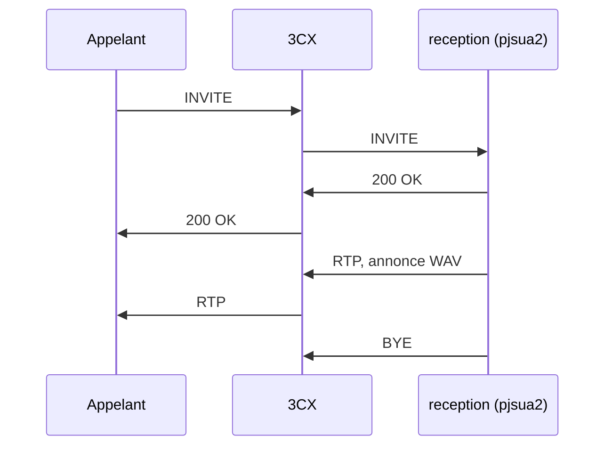

# Spécification — réceptionniste téléphonique, version 1

Hôtel Panorama, Grasse. Ce document fixe le comportement de la v1 et le
chemin vers l'architecture cible (3CX → LiveKit → Grok Voice, Opus de bout
en bout). Les notes de conception jointes décrivent les versions suivantes.
Elles ne sont pas implémentées ici.

## Comportement v1

Le programme est un agent SIP. Il s'enregistre auprès d'un trunk ou d'une
extension 3CX, décroche les appels entrants, joue une seule phrase, puis
raccroche.

Phrase exacte :

> Bonjour, je suis le réceptionniste de l'Hôtel Panorama

Scénario nominal :

1. Au démarrage, la pile PJSUA2 crée un transport SIP (UDP par défaut) et un
   compte. Le compte envoie `REGISTER` vers `sip:<domaine>:<port>` avec
   authentification digest. Le renouvellement est celui de PJSUA2.
2. Un `INVITE` entrant crée un appel. Le programme répond `200 OK` tout de
   suite, sans annonce de sonnerie.
3. Quand le média audio est actif, le fichier WAV est transmis une seule
   fois vers l'appel (`PJMEDIA_FILE_NO_LOOP`). Le micro n'est pas raccordé :
   la v1 n'écoute pas l'appelant et n'a pas besoin de carte son
   (périphérique nul).
4. À la fin du fichier, le programme envoie `BYE`.
5. Si l'appelant raccroche avant la fin, aucun `BYE` n'est envoyé.

Plusieurs appels sont acceptés dans le même processus, jusqu'à 4 (limite
`maxCalls`, la même marge que le trunk prévu pour l'hôtel). Chaque appel
joue la même annonce puis raccroche. Il n'y a pas de file d'attente, pas de
transfert, pas de dialogue.

`--check` valide les variables et le WAV, puis quitte. Il ne s'enregistre
pas et n'a pas besoin de la bibliothèque native.

## Hors v1

- Pont RTP vers une room LiveKit.
- Grok Voice, ou tout autre modèle.
- Barge-in, écoute de l'appelant, DTMF, transfert vers la réception.
- Enregistrement, transcription, résumé, page web de la réception.
- Négociation Opus. La roue utilisée ne contient pas Opus.
- TLS SIP, IPv6, vidéo.

## Choix de la bibliothèque SIP

**PJSUA2**, via la roue `pjsua2-python==2.15.1.post1` (PJSIP 2.15.1, mai
2026).

C'est la pile nommée dans le plan d'architecture : endpoint, compte du
trunk, rappel d'appel entrant, décrochage. Le même objet d'appel exposera
plus tard le média à relier à LiveKit. L'authentification digest, le
`REGISTER` périodique, la négociation SDP et le lecteur WAV sont déjà dans
cette pile, donc la v1 n'écrit pas de SIP à la main.

PyVoIP est à l'arrêt. `rfcvoip` est un successeur pur Python, maintenu, avec
un Opus optionnel : c'est un repli crédible, mais il faudrait le jeter au
moment du pont média, alors que le plan reste sur PJSUA2. La roue évite de
compiler PJSIP sur Linux x86_64, macOS et Windows, avec Python 3.8 à 3.12.

Les rappels sont exécutés sur le fil principal (`threadCnt = 0`,
`mainThreadOnly`). Les bindings SWIG plantent souvent quand un fil natif
entre dans un objet Python. Le programme appelle `libHandleEvents` dans sa
boucle.

PJSIP est publié sous GPL-2.0-or-later. Distribuer un binaire qui lie cette
roue emporte les obligations de cette licence.

## Annonce vocale

Le fichier joué est `assets/greeting_fr.wav` : PCM 16 bits, 16 kHz, mono,
environ 3,8 s. Il est produit **à l'avance**. Un appel ne contacte aucun
service de synthèse.

Moteur retenu : **gTTS** 2.5.4 (bibliothèque Python, français), puis
`ffmpeg` vers le WAV ci-dessus. Le manifeste `assets/greeting_fr.json`
enregistre la phrase, le moteur et la durée.

`edge-tts` a été essayé et refusé : le service vocal Edge répond 403 dans
cet environnement. `scripts/generate_greeting.py` retombe sur `espeak-ng`
(voix `fr-fr`) si gTTS échoue. Les deux chemins passent par ffmpeg pour
obtenir le même format.

La v1 ne prouve pas le contenu du WAV par une reconnaissance vocale. Les
tests vérifient la phrase du manifeste, le format, le niveau (pas un
fichier silencieux) et le fait que PJSUA2 atteint la fin de fichier une
seule fois.

## Architecture v1



Modules :

| Module | Rôle |
| --- | --- |
| `reception/config.py` | Variables d'environnement, URI d'identité et de registrar |
| `reception/greeting.py` | Phrase v1 et validation du WAV |
| `reception/flow.py` | Automate : décrocher, jouer une fois, raccrocher |
| `reception/codecs.py` | Priorités PCMA, PCMU, G.722 |
| `reception/sip.py` | Endpoint, compte, appel, lecteur WAV |
| `reception/cli.py` | `--check` et boucle principale |
| `scripts/generate_greeting.py` | Régénération du WAV |

`flow.py` ne connaît pas PJSUA2. Les tests d'appel passent par cet automate.
`sip.py` n'est importé qu'au lancement réel, donc `--check` fonctionne même
si la roue native est absente.

Codecs proposés, dans cet ordre : PCMA (loi A, usage en France), PCMU,
G.722. Speex, iLBC, GSM et L16 sont désactivés. Le pont de conférence
rééchantillonne le WAV 16 kHz vers le codec retenu. `noVad` est activé pour
ne pas couper le début de la phrase.

Ports RTP et RTCP : de `RTP_PORT` à `RTP_PORT + 21` inclus (défaut 4000–4021).
PJSUA prend les RTP pairs jusqu'à `port + portRange` et le RTCP sur le port
suivant. Le verrouillage de codec par re-INVITE est désactivé, pour ne pas
couper l'annonce.

## Vers LiveKit, Grok Voice et Opus

Le plan cible reste valable. La v1 s'arrête à l'étape 2, plus la lecture
d'un fichier. La suite se branche sur l'appel déjà décroché, sans changer
l'enregistrement SIP.


Correspondance avec le plan :

1. **Environnement.** La v1 installe PJSUA2. Le SDK LiveKit et le client
   Grok Voice ne sont pas des dépendances.
2. **Session SIP.** Fait : endpoint, compte, rappel, décrochage. La lecture
   WAV et le `BYE` sont le comportement provisoire à remplacer par le pont.
3. **Pont RTP.** À l'état média actif, au lieu de `AudioMediaPlayer`, lire
   le port RTP négocié, décoder (Opus s'il est négocié), publier des trames
   PCM sur une piste d'une room LiveKit créée pour cet appel, avec un jeton
   émis par le processus.
4. **Grok Voice.** Un participant abonné à cette piste envoie les trames et
   republie les chunks de réponse sur le média de l'appel SIP.
5. **Synchro.** Horodatage RTP d'un côté, horodatage de trame LiveKit de
   l'autre, alignés à chaque publication.

Chaque appel aura sa room et son participant, comme prévu. Le routage reste
dans 3CX. Le transfert réceptionniste (REFER, ou réceptionniste dans la
room), l'egress, le résumé et l'affichage ne font pas partie de cette
version.

**Opus.** Le forcer de bout en bout est le bon choix pour éviter le
transcodage, et LiveKit le parle nativement. La roue 2.15.1 ne l'inclut
pas : `getCodecOpusConfig()` renvoie `PJ_ENOTSUP`, et `codecEnum2()` ne
liste pas `opus/48000/2`. `codec_priority()` renvoie donc 0 pour Opus. Le
jour où pjproject est recompilé avec Opus, cette fonction est l'endroit où
le placer au-dessus de PCMA. D'ici là, l'extension 3CX doit proposer PCMA,
PCMU ou G.722. Un trunk réglé « Opus seulement » ne pourra pas établir le
média avec cette v1.

## Configuration

Fichier `.env` (voir `.env.example`). Les variables déjà présentes dans
l'environnement l'emportent sur le fichier.

| Variable | Obligatoire | Défaut | Rôle |
| --- | --- | --- | --- |
| `SIP_USER` | oui | | Utilisateur SIP, aussi identité dans l'URI |
| `SIP_PASSWORD` | oui | | Secret digest, jamais journalisé |
| `SIP_DOMAIN` | oui | | Hôte ou IPv4 du registrar, sans port |
| `SIP_PORT` | non | `5060` | Port du registrar |
| `SIP_TRANSPORT` | non | `udp` | `udp` ou `tcp` |
| `SIP_LOCAL_PORT` | non | `5060` | Port d'écoute local (`0` = port éphémère) |
| `SIP_AUTH_USER` | non | `SIP_USER` | Identifiant digest si 3CX le distingue |
| `SIP_PUBLIC_ADDRESS` | non | | IP annoncée dans le Contact et le SDP |
| `RTP_PORT` | non | `4000` | Premier port RTP |
| `GREETING_WAV` | non | `assets/greeting_fr.wav` | Annonce |
| `LOG_LEVEL` | non | `INFO` | `DEBUG`, `INFO`, `WARNING`, `ERROR` |

URI d'identité : `"Hotel Panorama" <sip:<user>@<domaine>>`.
URI de registrar : `sip:<domaine>:<port>` (`;transport=tcp` si besoin).
Le realm digest est `*`, pour accepter le realm envoyé par 3CX.

Sur 3CX, créer une extension SIP (ou un trunk avec enregistrement) et router
un numéro de test vers elle. Le programme est le client qui s'enregistre :
3CX doit pouvoir le joindre sur le Contact qu'il publie, et atteindre la
plage RTP. Derrière un NAT, renseigner `SIP_PUBLIC_ADDRESS` et ouvrir ces
ports. Ce dépôt ne contient pas les identifiants du PBX.

## Dépendances et installation

Exécution :

- Python 3.10, 3.11 ou 3.12.
- `pjsua2-python==2.15.1.post1`
- `python-dotenv`

Développement : `pytest`.
Régénération audio : `gTTS` et le binaire `ffmpeg`. `espeak-ng` est le repli
hors ligne.

Roues publiées pour cette version de pjsua2 : Linux x86_64, macOS (arm64 et
x86_64), Windows amd64, Python 3.8 à 3.12. Il n'y a pas de roue Linux
aarch64 ni de roue Python 3.13. Un Raspberry Pi, ou Python 3.13, demande une
compilation de [pjproject](https://github.com/pjsip/pjproject) avec SWIG et
les en-têtes Python. Pour Opus, cette compilation doit activer libopus ;
la roue actuelle ne le fait pas.

```bash
python3 -m venv .venv
source .venv/bin/activate
pip install -r requirements.txt
cp .env.example .env
python -m reception --check
python -m reception
```

Tests, sans trunk :

```bash
pip install -r requirements-dev.txt
pytest
```

Régénérer l'annonce :

```bash
pip install -r requirements-tts.txt
python scripts/generate_greeting.py
```

Un service systemd peut garder le processus en avant-plan :

```ini
[Service]
WorkingDirectory=/opt/receptionniste-hotel
EnvironmentFile=/opt/receptionniste-hotel/.env
ExecStart=/opt/receptionniste-hotel/.venv/bin/python -m reception
Restart=on-failure
```

## Tests

Sans trunk et sans identifiants :

- variables manquantes ou invalides, URI, mot de passe absent des journaux
  de contrôle ;
- phrase exacte, format du WAV versionné, rejet du silence et de la stéréo ;
- automate : un décrochage, une lecture, un raccrochage, pas de `BYE` si
  l'appelant est déjà parti ;
- priorités de codecs, Opus désactivé ;
- `--check` ;
- lecture réelle du WAV par PJSUA2 sur le périphérique nul, fin de fichier
  unique. Ce test est ignoré si la roue n'est pas installée.

Aucun test ne passe un appel. Le premier appel réel se fait depuis un
poste ou un mobile vers l'extension de test, une fois `.env` rempli.

## Limites connues

- Pas d'Opus dans la roue `pjsua2-python` 2.15.1. Pas de roue Linux aarch64
  ni Python 3.13.
- Pas de traversée NAT automatique (pas de STUN, pas d'ICE).
- La qualité de l'annonce est celle de gTTS, pas une voix Grok.
- Un échec de négociation codec (par exemple 488) apparaît dans le journal
  d'état d'appel ; le programme ne réessaie pas avec un autre profil.
- Le mot de passe SIP vit dans `.env` sur la machine qui s'enregistre.
